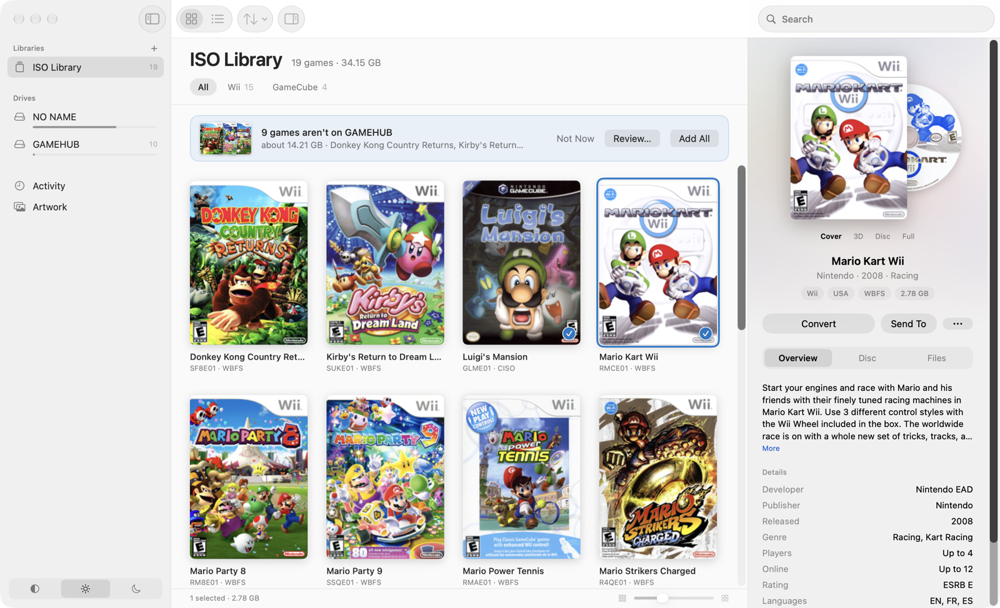
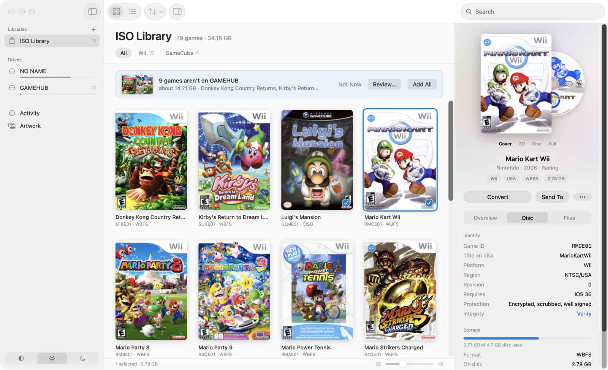
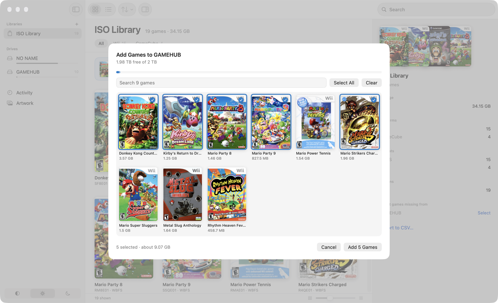
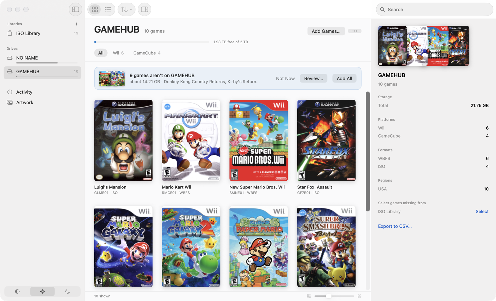
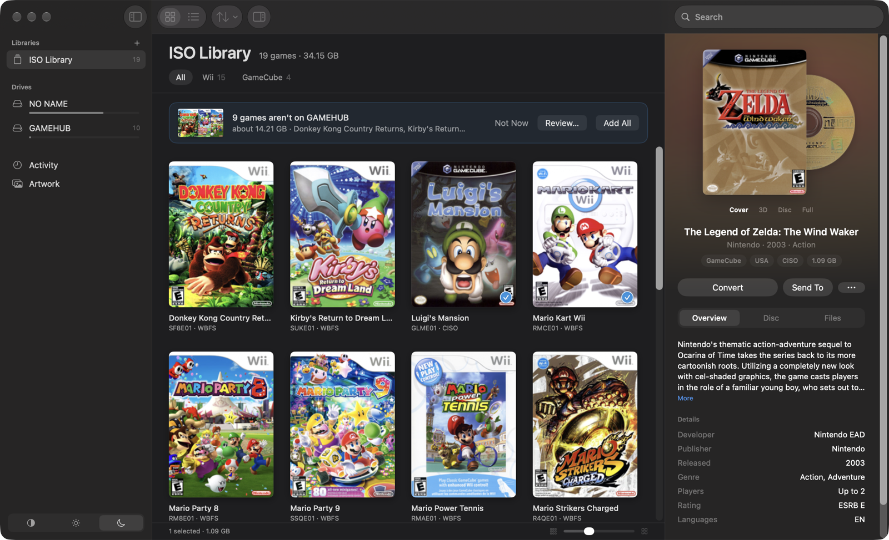

# Wii and GameCube Game Manager for Mac

A native Mac app for managing Wii and GameCube backups: browse them by cover, read what's on each
disc, convert between formats, and set up a USB drive that USB Loader GX, WiiFlow and Nintendont
can load from. No games, keys or artwork are included. You bring your own backups, and artwork
comes from [GameTDB](https://www.gametdb.com) when the app needs it.

It began as a macOS rebuild of the Windows tool Wii Game Manager 1.5.



## Download

Get **Wii-and-GameCube-Game-Manager.zip** from the [latest release](../../releases/latest), unzip it and move
the app to Applications. It's self-contained, so there's nothing else to install. It needs macOS 15
or later, on Apple Silicon or Intel.

**First launch:** this build isn't notarized by Apple, so macOS blocks it the first time. Open the
app once, then go to **System Settings > Privacy & Security** and choose **Open Anyway**. You only
need to do this once.

To skip that step, install from Terminal instead:

```sh
curl -fL https://github.com/LifeExtender/wii-and-gamecube-game-manager-mac/releases/latest/download/Wii-and-GameCube-Game-Manager.zip -o /tmp/wgm.zip
ditto -x -k /tmp/wgm.zip /Applications
```

## What it does

- **Library:** a cover grid or sortable list of everything in your folders, with search and filters
  by platform and region. Drop in a folder or disc image to add it.
- **Reads every common format:** ISO, WBFS, WDF, CISO, WIA, GCZ and raw WBFS partitions. RVZ isn't
  supported.
- **Disc details:** region, revision, required IOS, signing state, real size, partitions and a
  searchable file tree. Wii discs can be checked against their own hashes.
- **Convert:** create `.wbfs` or `.iso`, split at 2 GB or 4 GB, resplit, copy and move.
- **USB drives:** connected game drives appear automatically, with their free space.
  - **Add Games** writes Wii games to `/wbfs/Title [ID]/ID.wbfs` and GameCube games to
    `/games/Title [ID]/game.iso`, and removes the hidden `._` files macOS leaves behind.
  - A banner offers any games in your libraries that a drive doesn't have yet.
- **Formatting:** FAT32 (recommended) or WBFS.
- **Artwork and game info:** covers, 3D covers, disc art, synopsis, controllers and more.
- **System, Light and Dark** appearance.

## Screenshots

| Details read from the disc | Adding games to a drive |
| --- | --- |
|  |  |

| A connected game drive | Dark appearance |
| --- | --- |
|  |  |

## Formatting safety

Formatting only ever offers external physical drives. Internal, startup and virtual disks are
refused, and any uncertainty about a drive counts as a refusal. You have to type a confirmation
naming the disk, and the app checks the drive's identity again immediately before erasing.

FAT32 is the right choice for almost everyone. A raw WBFS drive holds no GameCube games, can't be
browsed in Finder, and may need Full Disk Access on recent versions of macOS.

## Building from source

You'll need Xcode 16 or later and [XcodeGen](https://github.com/yonaskolb/XcodeGen).

```sh
brew install xcodegen
scripts/fetch-tools.sh   # downloads and verifies the disc tools
xcodegen generate
open WiiGameManager.xcodeproj
```

`scripts/build-release.sh` produces the distributable zip. Builds are ad-hoc signed unless you add
your own identity, as described in `Config/Signing.xcconfig`.

To run the tests:

```sh
cd WiiKit && swift test
```

The integration tests run the real disc tools on synthetic discs and attach temporary disk images.
They need about 10 GB of temporary space and never touch a physical drive.

## How it's organised

- `WiiKit/` holds everything with no user interface, and all of the tests: reading and writing
  discs, the drive safety checks, the job queue and GameTDB.
- `App/Model/` holds the app's state, with one extension per feature.
- `App/Views/` holds the SwiftUI interface.

## Credits and licence

Copyright © 2026 LifeExtender. Licensed under the GNU General Public License, version 2 or later.
See [LICENSE](LICENSE).

All disc work is done by [Wiimms ISO Tools](https://wit.wiimm.de) by Dirk Clemens, which is also
GPL v2 or later and is bundled in the app. Its source is attached to each release, and
`Helpers/PROVENANCE.txt` explains where the binaries come from. Titles, game data and artwork are
provided by GameTDB.
